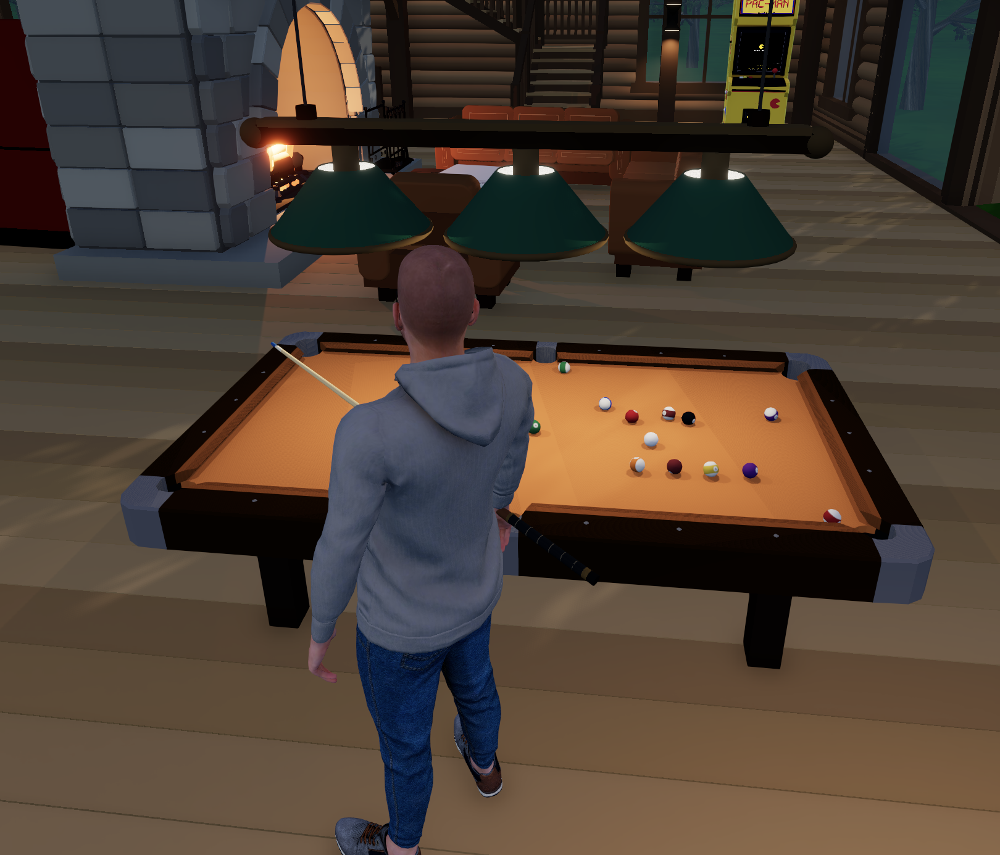

# Hyperfy Billards



A standalone, server-owned pool practice app for
[jerometremblay/hyperfy](https://github.com/jerometremblay/hyperfy) (Hyperfy 0.16).
The included `.hyp` packages contain their models, physics code, spatial sound
samples and numbered ball textures. The physics needs no external service or
runtime downloads. The close, animated camera return uses the engine's native
player camera API. Playing requires a held cue from the companion four-cue rack
(`dist/collection/CueRack.hyp`).
Stationary tables and empty cue racks register no frame updates. Server physics
runs while balls move; client updates stop after input, interpolation and sounds
finish. Snapshots and interaction events wake them again, and ownership leases
expire on a timer rather than an idle physics loop.

Based on [tailuge/billiards](https://github.com/tailuge/billiards), the original
open-source pool project by tailuge and contributors. The physics solver and
original table model are adapted from that project under GPL-3.0. See
[third-party attribution](THIRD_PARTY.md) for the pinned revision and changes.

## Showcase

[](https://youtu.be/Mat5QP7DeGY)

[Watch the gameplay showcase on YouTube](https://youtu.be/Mat5QP7DeGY).

## Included pool-room objects

`npm run build` produces four self-contained Hyperfy packages in `dist/collection/`:

- `PoolTable.hyp`: the original table model, simulator, numbered ball textures and four sound samples.
- `CueRack.hyp`: the four-cue rack and pickup/return controls.
- `PoolLight.hyp`: the triple pendant fixture, its model, materials and light-control script.
- `WallLightSwitch.hyp`: the wall switch and linked light-control script.

The fixture and switch's editable `object.json`, `model.glb` and `script.js` sources
are in `objects/apps/billiards-triple-green-pendant-light/` and
`objects/apps/billiards-wall-light-switch/`. They share the default
`pool-room-lights` channel. All four packages contain their referenced assets;
no runtime asset downloads or external catalog checkout are required.

The existing worldsync compiler and package helpers are vendored with their
source and license. npm dependencies are declared in `package.json` and pinned
in `package-lock.json`. Build, tests and validation require only this repository,
Node/npm and Python 3 for validation. Gameplay requires a compatible Hyperfy
server; local preview uses the engine checkout described below.

## Run

This repository installs its own dependencies and builds without a Hyperfy checkout.
Use the Node version in `.nvmrc` and npm 10 or newer:

```sh
npm ci
npm run build
npm test
npm run validate
```

For multiplayer gameplay, point the preview at a built checkout of this Hyperfy
fork. A sibling `../hyperfy` checkout is the default:

```sh
HYPERFY_ROOT=/path/to/hyperfy npm run preview
# Optional original table and fitted game:
HYPERFY_ROOT=/path/to/hyperfy npm run preview:overlay
```

Open http://localhost:3340. The preview starts the **real Hyperfy server** with
this repository's `.local-world` database and assets. It creates a practice table
and cue rack without changing another world's data. Build the engine with
`npm run build` in its checkout first. `BILLARD_PORT=3342 npm run preview` selects
another port; stop the existing preview before switching ports because the
isolated database is shared. Ctrl-C stops it.

`npm test` exercises the packaged script, physics, cues, sounds, and vendored
native Hyperfy nodes and all four pool-room objects without an engine checkout.
Optional integration checks verify the engine's wall light switch with the bundled
pendant fixture, plus fireplace pickup hints:

```sh
HYPERFY_ROOT=/path/to/hyperfy npm run test:integration
```

`dist/preview.html` is a separate, offline geometry viewer. It executes the exact
packaged script and reads the exact packaged PNGs. It supports six inspection
views and orbit/zoom. It does not emulate multiplayer gameplay.

## Controls

Point at a cue on the wall rack and click, or hold **E**, to take it. **X** returns
it to the rack. Then hover over the playing surface or a ball to see Hyperfy's
built-in mouse-icon **Play** hint, and click to aim. Both the Play hint and the
hourglass shown while a shot runs are centered below the pointer at 50% opacity.
The hourglass appears only over the playing surface or balls. Cues work on every table, and players can hold only one cue across all racks.
The server checks actual rack
ownership before granting controls and again on each shot/place/reset. Pickup
and return identify players from the transport sender.

While standing or walking, the cue sits inside the curled fingers, with the
thumb closing from the opposite, wrist side of the shaft. This finger-only pose
leaves the native arm and wrist animation intact and yields to the aiming pose.
After a shot, the fingers blend directly from the shooting grip into the carrying
grip during the same one-second body rise, without passing through an open hand.

Entering aim blends the standing body, arms and fingers into the shooting stance
over one second, with the same easing as the rise after a shot. The camera takes one straight path
from the exact view visible when Play is clicked to the fully lowered right eye,
looking at the cue ball,
with the same easing as the return to third-person after a shot. That view is
captured before the aim request and retained while the server accepts the stance.
The held cue
follows the rendered grip hand throughout lowering and reaches its exact aiming
alignment with the hand; attachment updates after the native avatar animation. An early Space press still starts the shot immediately and finishes
lowering during the backswing. The local avatar and eye view predict the stance from the current
input every frame, without waiting for a server reply or changing the player's
physical transform. The server validates aim and calculates the actual stance;
observers receive that accepted movement and aim later. Ball positions,
placement acceptance, collision physics and shots remain server-owned.
The camera follows the solved eyes during the stroke. The local visual
stance and stroke start locally on Space press. Each client advances one continuous
stroke without resetting its clock when packets arrive. Standing begins after the
minimum follow-through and Space release; delayed packets cannot restart the pose. Native
first-person visibility hides the local head. During lowering and rising, the
local body is also hidden while arms and hands stay visible; other players still
see the full avatar. If a right-eye bone is missing, the camera estimates its
position from the left eye or head, with a rightward offset scaled to avatar height. Mouse movement orbits the ball and changes aim. Cancelling restores the
previous camera. The avatar moves close enough to hold the cue while its
collision capsule stays outside the rails. The actual held 1.47 m cue aligns
behind the ball, including spin offsets. Other players see both the cue and the
avatar's low aiming stance. There is no trajectory line.

- Mouse or left/right arrows: turn aim. Scroll back to pull the cue farther from
  the ball for a stronger shot; scroll closer for less force (0.1–5 m/s).
  Up/down arrows also adjust power. Other players see the cue's pullback.
- W/S: top/back spin. A/D: side spin. Offset is limited to 0.45 ball radii.
- Space: start the forward stroke and release aiming inputs immediately.
  Hold Space to stay down in the final follow-through pose; release it to rise.
  A quick tap retains the existing minimum follow-through delay.
  A brief 0.10-second backswing leads into the forward hit. At contact, the cue
  matches the physics launch speed, including the reduction from spin offsets.
  The white is struck after 0.30 seconds when the cue reaches it; the grip arm
  and cue follow through, then the avatar rises over one second once Space is released. The aiming
  camera returns directly to the final native third-person view at its nearest
  zoom (0.3 m), in one eased movement during that same second. The torso and head stay
  hidden locally until the return finishes, with both arms and hands visible.
  Other players see the full rising avatar. Normal movement remains available; mouse look, zoom and wall collision
  resume with the native camera. Click Play on the table again for your next shot.
- After a scratch: mouse or left/right arrows orbit the white ball as usual.
  WASD moves the actual white-ball mesh across the cloth relative to the view
  (W forward, S backward, A left, D right), with the camera following its position.
  Other nearby players see the white ball while it is being positioned, including
  players who join during placement. Left click or Space confirms placement and
  continues aiming; Escape cancels the shared preview.
  The server rejects occupied or out-of-bounds positions.
- R: re-rack while stopped. Escape: release the camera and movement controls.

Other nearby players see the same balls. One player owns the controls at a time.
Leaving the area, disconnecting, or letting the 60-second lease expire frees the
table. Returning the cue also cancels aiming. A client renews the lease every
15 seconds while aiming. Each accepted strike releases ownership. Balls continue
moving after their shooter leaves. A server restart or blueprint rebuild starts
a fresh rack; in-progress practice is not persisted.

## Avatar aiming and stroke

The stance uses Hyperfy's existing normalized VRM poses and WebXR arm/hand IK,
through this fork's client-only `player.setPose` method. The body leans over the
cue with bent knees; the open bridge stays on the cloth and the closed grip
follows the cue. Existing avatar height and bone measurements adapt the crouch,
and shoulder width keeps the cue outside the torso. The crouch keeps the torso
above the rail. When the ball is farther inside the table, the hips advance and
rise, the knees straighten and the body bends progressively lower over the
cloth. For distant shots, the pose adds a step of up to 14 cm toward the
rail, allowing the shoes to tuck beneath the apron. The collision capsule stays
outside the table; normalized leg rotations keep the feet grounded without
stretching the legs. The bridge
advances with the shoulders and stays planted throughout the stroke. For longer
reaches, the grip moves toward the cue's butt and the bridge length grows while
leaving clearance for follow-through. The shooter's existing right-eye camera
follows the solved body, and observers see the same stance. Measured palm length
and finger width fit both hands to the shaft. The normal bridge wrist stays at a fixed height above the cloth, independent of spin.
Measured finger lengths lower the first joints; both outer segments stay horizontal
with their pads on the surface. The normal bridge remains selected while its heel and
spread fingers fit on the cloth. When space gets tight, a compact cloth bridge shortens
the hand's footprint and bends the outer fingers steeply onto the playing surface.
If that no longer fits, a rail bridge lays the shaft directly on the rail, with the
thumb beside it and the index arched over it. The outside-face bridge is reserved for
balls almost against the cushion; shots running along a rail retain the raised open
bridge. Each change selects a complete pose and uses the native 500 ms transition,
which finishes even when the aim stops moving. Placement stays anchored to the cue
line on diagonal and corner shots.
The rail forms follow [Mark Finkelstein's reference photographs](https://www.pooldawg.com/article/proper-form-for-bridging-on-the-rail/)
and [Jacob Parrent's bridge guide](https://www.worldofpoolandbilliards.com/post/the-bridge-in-pool).
A slight body turn places
the bridge shoulder forward and the grip shoulder back. The bridge hand reaches
ahead of its elbow, and the grip elbow bends upward with a slight outward bias
for deeper shots, keeping it outside the torso throughout follow-through. Wider
avatars gain a small sideways body offset, with the planted bridge adjusted to
remain reachable. The grip
uses native articulated hand poses: curved fingers surround the actual shaft
and the thumb hangs down beside the index and middle fingers. Its opposition
adapts to palm size, keeping the thumb pad beside the shaft throughout the stroke. For deep shots the height-adjusted grip
moves farther back, leaving at least 13.5 cm of shaft behind the hand. The body
advances gradually to preserve reach during the strongest backswing. Native IK
retains each avatar's real arm lengths. Power pulls the cue back
up to 14 cm, leaving room for the extra backswing within the existing 16 cm
reach. The server reserves the table during the backswing and accelerating
forward stroke. The cue reaches the actual launch speed at contact and slows
smoothly into follow-through. The server strikes once and shares the follow-through state
with observers and late joiners. Escaping aim, returning a cue, leaving, or
removing the app restores normal animation. A cue return or disconnect before
impact cancels the pending strike. Rendering and physics callbacks sleep again
when their work finishes.

The movement is based on [WPBSA coaching basics](https://wpbsa.com/wp-content/uploads/WPBSA-The-Basics-updated-AMEND-MAY-2021-002.pdf)
(fixed bridge, low head, grip forearm underneath the elbow) and
[Dr. Dave's stroke guidance](https://drdavepoolinfo.com/resource_files/stroke_best_practices.pdf)
(backstroke pause, smooth acceleration, follow-through, steady body).
Hand placement also follows [Samm Diep's open-bridge reference photographs](https://www.pooldawg.com/article/the-bridge-to-victory/)
(spread fingers and raised thumb against the index) and
[Florian Kohler and Valerie Bedard's grip photographs](https://www.pooldawg.com/article/advanced-fundamentals/)
(a loose rear grip, straight wrist and fingers curled under the cue).
[Jacob Parrent's grip close-ups](https://www.worldofpoolandbilliards.com/post/how-to-grip-a-pool-cue)
show the downward thumb closing against the index and middle fingers. These are
pose references; the photos are not included as game assets.
The same aiming and stroke code is rendered by every nearby client; body poses
are not sent as per-bone network packets. Clients without this fork's `setPose`
API still display the physical cue and play the timed shot.

This is a procedural stance rather than motion capture. Extremely short
avatars and long reaches across the table can hit the native arm-reach limit;
limbs are not stretched, and a mechanical bridge is not included.

## Fit it to an artist's table

The app origin is **the centre of the cloth surface**, with +Y up, +X along the
long rail and -Z forward. Use scale `[1,1,1]`, keep it level, and position/rotate it
independently of the furniture. The editor offers WPA 9-foot (2.54 × 1.27 m) and
8-foot (2.3368 × 1.1684 m) playing surfaces. These are nose-to-nose dimensions,
not the furniture's exterior size. Balls have 57.15 mm diameter and 170 g mass.

Turn **Show practice surface** off to retain only the simulated balls and controls.
For another artist's table, hide its static balls and align the overlay before
combining them. The bundled pool table uses the original Tailuge model,
as described below.

### Original table model

`dist/collection/PoolTable.hyp` includes the original Tailuge table model and
fitted game. The model comes from upstream `dist/models/p8.min.gltf` at the same
pinned revision as the physics. It is converted to a self-contained Y-up GLB,
with its end sections translated to fit the regulation 8-foot surface while
retaining the original pocket sizes. The cloth is at local Y=0.708 m. The
upstream asset is a tabletop; four plain support legs are added to ground it.
Use entity scale `[1,1,1]`.

The built-in left-mouse **Play** hint appears over the playing surface and balls
only, while holding a rack cue and while the balls are stopped. The rails and
supports do not start a game; clicks during a shot are ignored. Escape leaves.
As with any in-world camera, other avatars can walk in front of the view.

Run `npm run build` to rebuild the table and combined preview.
`npm run preview:overlay` uses the original model and fitted game in the isolated
local world. Editable model sources and provenance are in `upstream-table/`;
`overlay/fit.json` records the game alignment and regulation 8-foot dimensions.

## Physics choice and limits

Reuses [tailuge/billiards](https://github.com/tailuge/billiards), pinned to
`b23b1d9f0da103783f70fa48a6c6f7f288290d9e`. The headless subset retains its ball
motion, sliding/rolling friction, spin, collision throw, Han-blend cushion
response, rounded pocket jaws, and pocket capture/fall code. The adapter supplies
standard surface dimensions and ball mass/radius, a fixed 1/480-second step, and
bounded inputs. Ball collision restitution is upstream's **0.925**, not 1.

The table's **Rolling resistance (1 = normal)** setting controls cloth friction.
It defaults to `1`, preserving the existing roll; use `2` for twice the rolling
resistance and shorter travel. The range is `0.25`–`4`, in `0.05` steps. It scales upstream's
rolling-friction coefficient (`0.007 × setting`) and its associated spin decay.
Sliding friction, shot power and collision restitution stay unchanged. The
server applies the setting to its simulation; clients still display snapshots.
Rolling resistance updates live without reracking, restarting aim or interrupting
an active stroke. Moving balls keep their current position and velocity and use
the new friction from the next server physics step. Other table properties still
use the normal app reload. Live property updates require this fork's `live: true`
field support.

This is a numerical model, not perfect physical truth. Upstream detects predicted
end-step overlaps; it is not an exact event-time solver. Small steps and bounded
speed reduce missed contacts but do not prove every grazing or simultaneous
contact. Pocket circles/jaws retain upstream proportions; they are not a certified
WPA pocket cut. The six black disks on the practice surface mark capture zones.
The app provides no jumps, masse/elevated-cue shots, full 8-ball foul/win rules,
VR cue tracking, tournament scoring, or durable match persistence.

The server alone advances physics. Clients render snapshots at up to 20 Hz with
100 ms interpolation. Cue strikes, ball collisions, cushion hits and pocket drops
play as spatial effects on that same simulation timeline, with volume based on
impact speed. Events are sent once in snapshot batches; late joins skip historical
sounds, resets clear queued effects, and effects more than 120 ms behind displayed
physics are skipped. Up to 24 overlapping voices are allowed; negligible impacts
(below 0.03 m/s) are silent. Audio also stops beyond 15 m.

Four unmodified Ogg Vorbis samples from the pinned Tailuge revision are embedded
as audio props and preloaded with the blueprint: `cue.ogg`, `ballcollision.ogg`,
`cushion.ogg`, and `pot.ogg`. File hashes and source paths are recorded in
`sounds/provenance.json`. The app audio fields can replace `soundHit`,
`soundCollision`, `soundCushion`, and `soundPot`. Playback uses native
Hyperfy audio nodes and the SFX volume setting; a world click is required to
unlock browser audio. The visible table settings include **Sound volume (1 = normal)**:
0 mutes, 1 restores the standard level, and values up to 5 boost all impact sounds.
This table setting updates active effects and future impacts without restarting
the pool simulation; the global SFX volume still applies.
Timing is frame based, not sample accurate.

All connected clients receive the normal Hyperfy app
broadcast; ball rendering stops beyond 15 m. Interest-managed network delivery
would need a later engine feature.

Dimensions source: [WPA Recommended Equipment Specifications](https://www.wpapool.com/wp-content/uploads/2024/01/RECOMMENDED-EQUIPMENT-SPECIFICATIONS.pdf),
sections 5 and 16. The 8-foot specification here is the WPA 92 × 46 inch surface,
not the common domestic 88 × 44 inch surface.

## Validation and licensing

See `validation/REPORT.md` for executed checks and boundaries. Run `npm run build`
before `npm test`; tests exercise the distributed script as well as source physics.
Source and vendor notices are included in `dist/hyperfy-billard-source.zip`.

GPL-3.0-only. See `LICENSE` and `THIRD_PARTY.md`. Do not remove upstream notices
when distributing the `.hyp`; provide the accompanying source archive too.

The close shot handoff requires this fork's local `player.setCamera({target, zoom})` API. Reload clients after updating the engine build.

Play is hidden while aiming. Each new aiming session resets top and side spin to zero.

After follow-through, the local solved body, arms and fingers blend back into normal avatar animation over one second with the camera return. Observers use a 450 ms release. A new aim blends from the currently rendered pose; the table needs no extra idle frame callback.
